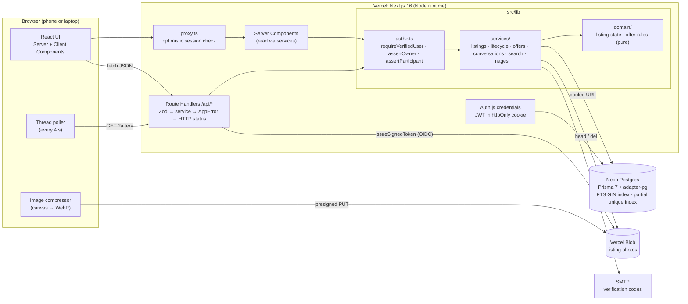
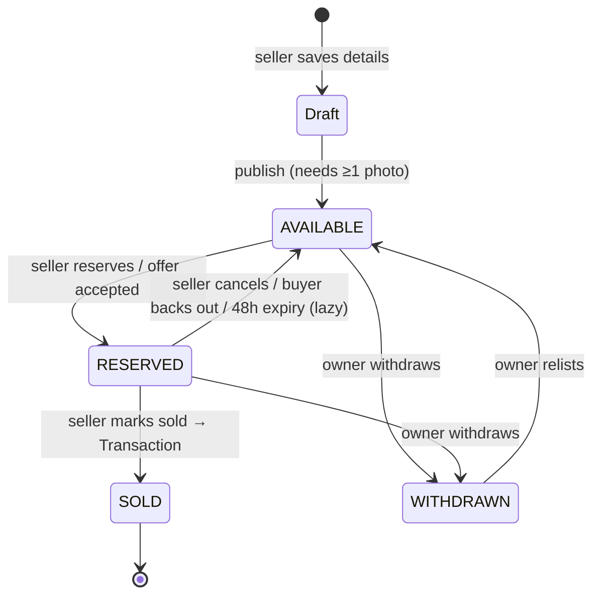

# CampusCart

A buy-and-sell marketplace for students of one college. Members verify with their college email, list second-hand items with photos, negotiate in threaded inquiries with offers, and reserve and complete sales through an enforced listing lifecycle.

- **Live app:** https://campuscart-mu-navy.vercel.app
- **Repository:** https://github.com/parvcsinclined/campuscart

## Problem statement

Students regularly need affordable second-hand textbooks, calculators, furniture and electronics, and the students who own them are often in the same building. General marketplaces are full of strangers and sellers who are far away. WhatsApp groups can't keep track of who reserved what, so items get promised twice, buyers keep asking "is this still available?", and the price someone agreed to is lost in the scroll.

## Target users

Students of a single college, verified by their college email address (e.g. `@sst.scaler.com`). Each student can act as a **buyer** and a **seller**.

## Solution

CampusCart makes the marketplace software rather than a chat thread:

- **Verified campus membership.** Only allow-listed college email domains can sign up, and an emailed code must be confirmed before a student can list, message or make offers.
- **A real listing lifecycle** (Available → Reserved → Sold, plus Withdrawn). The rules are enforced on the server, so an item can't be reserved by two buyers at once.
- **One conversation per buyer per listing.** Price offers sit inside the thread, so the whole negotiation history is visible.

## Key features

- **Campus-restricted accounts:** domain allowlist (exact match), bcrypt-hashed passwords, 6-digit email verification codes (hashed, 15-minute expiry, 5 attempts), and rate-limited sign-up and login.
- **Listings with photos:** title, description, category, condition, integer INR price and campus pickup point. Each listing has 1–5 photos, which are compressed in the browser and uploaded directly to Vercel Blob with per-photo progress, errors and retry. Drafts stay private until published.
- **Ownership rules:** only the seller can edit, publish or delete. Sold listings are locked. Listings that buyers have already messaged about can only be withdrawn, not deleted.
- **Search & filters:** prefix keyword search over title and description (Postgres full-text search on a generated, weighted `tsvector` column with a GIN index). Filter by category, condition, price range and status (Available by default, optionally Reserved). Sort by best match, newest or price, with pagination. All state lives in the URL, so searches can be shared and survive a refresh.
- **My listings,** grouped into Drafts, Available, Reserved, Sold and Withdrawn.
- **Inquiries & messaging:** a buyer opens exactly one conversation per listing (a unique constraint; opening it again returns the same thread). Only the two participants can read or post, which is checked on the server. New messages arrive by polling every 4 s (paused while the tab is hidden, with backoff on failures). The inbox shows unread counts, and the nav shows a total badge.
- **Offers & negotiation:** the buyer makes a price offer inside the thread. The recipient can accept, decline or counter, and the proposer can withdraw. Only one offer can be pending per conversation, and only on available items. Every offer and response appears in the thread, so the negotiation history is complete.
- **Reservations & lifecycle:** accepting an offer reserves the item for 48 hours at the agreed price. Sellers can also reserve, cancel or mark as sold from the conversation, and buyers can back out. Owners can withdraw and relist. When an item is reserved or sold, other buyers' pending offers expire and they get a system message explaining why. Every status change is recorded and shown to the seller as a timeline.
- **Purchases & sales:** completed transactions (buyer, seller, final price, date) on dedicated pages.

## Tech stack

| Piece | Why |
|-------|-----|
| **Next.js 16 (App Router, TypeScript)** | One codebase for the UI and the API (Route Handlers on the Node runtime), plus Server Components that read the database directly. |
| **PostgreSQL on Neon + Prisma 7** | Relational data with real constraints (unique conversation per buyer, one pending offer per conversation) and built-in full-text search. Prisma provides typed queries and migrations, and connects through `@prisma/adapter-pg`. |
| **Vercel Blob** | Photo storage with direct browser uploads, so large files never pass through the serverless functions. Authenticates with Vercel OIDC, so no long-lived token is needed. |
| **Auth.js (NextAuth v5)** | Credentials login with an encrypted JWT in an httpOnly cookie. |
| **Zod** | One schema per form, shared by the client (instant field errors) and the server (the source of truth). |
| **Tailwind CSS** | Fast, consistent styling with design tokens for light and dark mode. |
| **Vitest** | Unit tests for the pure business rules. |

## Architecture



### Listing lifecycle



Every arrow is one entry in `TRANSITIONS` (`src/lib/domain/listing-state.ts`). It runs as a conditional atomic update and writes a `ListingEvent` (who, from, to, when), which the seller sees as a timeline. Offers follow their own rules (`offer-rules.ts`): `PENDING → ACCEPTED | REJECTED | COUNTERED | WITHDRAWN | EXPIRED`.

### Data model

`User` · `VerificationToken` · `Listing` (+ generated `searchVector`) · `ListingImage` · `Conversation` (unique per listing + buyer) · `Message` (TEXT / OFFER / SYSTEM) · `Offer` (one PENDING per conversation) · `Transaction` (unique per listing) · `ListingEvent` · `RateLimit`. See `prisma/schema.prisma` and the init migration for the indexes behind search, filters and inbox queries.

- `src/lib/domain`: pure rules (listing state machine, offer rules), unit-tested.
- `src/lib/services`: database work for each feature. All business rules live here, not in routes.
- `src/app/api/**`: thin Route Handlers. They validate with Zod, call a service, and map `AppError`s to real HTTP status codes (400/401/403/404/409/429).
- `src/lib/authz.ts`: `requireVerifiedUser`, `assertListingOwner` and the other guards. They re-read the user from the database on every request, so a stale session can't bypass verification.

## Local setup

Requirements: Node 20+ and a Postgres database (Neon recommended).

```bash
git clone https://github.com/parvcsinclined/campuscart.git
cd campuscart
npm install                      # also runs `prisma generate`
cp .env.example .env             # fill in values (see below)
# or, if you have access to the Vercel project:
vercel link && vercel env pull .env.local
npx prisma migrate deploy        # create tables, search index and constraints
npm run db:seed                  # demo accounts
npm run db:seed:demo             # optional: 12 demo listings with photos + sample negotiations
npm run dev                      # http://localhost:3000
```

Useful scripts: `npm run lint`, `npm run typecheck`, `npm test` (Vitest), `npx vitest run src/lib/validation` (a single test folder).

Without SMTP configured, verification codes are printed in the dev server log.

## Environment variables

| Name | Description |
|------|-------------|
| `DATABASE_URL` | Neon **pooled** connection string, used by the app at runtime. |
| `DATABASE_URL_UNPOOLED` | Neon **direct** connection string, used by Prisma migrations. |
| `AUTH_SECRET` | Secret for encrypting session cookies (`npx auth secret`). |
| `ALLOWED_EMAIL_DOMAINS` | Comma-separated, exact-match email domains allowed to sign up. |
| `BLOB_STORE_ID` | Vercel Blob store ID (set automatically when the store is connected). |
| `VERCEL_OIDC_TOKEN` | Short-lived OIDC token used by Blob. Injected on Vercel; locally it comes from `vercel env pull`. |
| `SMTP_HOST`, `SMTP_PORT`, `SMTP_USER`, `SMTP_PASSWORD`, `EMAIL_FROM` | SMTP settings for verification emails (e.g. Gmail with an App Password). |

## Demo walkthrough

1. Log in as **seller@example.edu**. The inbox has a pending ₹550 offer on *CLRS*: accept, counter or decline it. *Engineering drawing kit* is reserved for Rohan: open the conversation to **Mark as sold** or **Cancel reservation**. Open any of your listings to see the status timeline.
2. Log in as **buyer@example.edu** in another browser. Browse and filter, message a seller, make an offer, and watch the seller's response arrive within seconds. *My purchases* shows a completed sale.
3. Log in as **buyer2@example.edu** and make an offer on the same item as Rohan. When the seller accepts one, the other offer expires with an explanation.

## Deployment

Deployed on Vercel from the `main` branch: every push builds and deploys. Neon Postgres and Vercel Blob are attached from the Vercel project's Storage tab. Migrations run with `npx prisma migrate deploy` against `DATABASE_URL_UNPOOLED`.

**Demo accounts** (pre-verified, on the demo domain `example.edu`):

| Role | Email | Password |
|------|-------|----------|
| Seller | `seller@example.edu` | `CampusCart-demo-2026` |
| Buyer | `buyer@example.edu` | `CampusCart-demo-2026` |
| Second buyer (for competing offers) | `buyer2@example.edu` | `CampusCart-demo-2026` |

## Key engineering decisions

- **Direct-to-storage uploads with OIDC.** The server checks that you're logged in and own the listing, then issues a presigned upload URL scoped to one exact pathname, `put` only, JPEG/PNG/WebP, at most 5 MB, valid for 10 minutes. The browser resizes the photo to at most 1600 px WebP and uploads it straight to Blob. A separate attach call then re-checks ownership and asks Blob for the object's real type and size before saving it. Upload webhooks can't reach `localhost`, which is why attaching is an explicit step.
- **Atomic reservations.** All lifecycle rules live in one pure state machine (`src/lib/domain/listing-state.ts`). The service executes a planned transition as `UPDATE "Listing" … WHERE id = ? AND status = <expected>`. If two buyers' reservations race, exactly one update matches and the other gets **409 Conflict**; this was verified with two simultaneous requests. Accepting an offer updates the offer (`WHERE status = 'PENDING'`) and reserves the listing in the same database transaction, so neither can happen without the other.
- **One pending offer, enforced by the database.** A partial unique index (`ON "Offer"("conversationId") WHERE status = 'PENDING'`) backs the application check, so a double-click or two tabs can't create two pending offers.
- **Lazy expiry instead of a job queue.** A reservation stores `reservedUntil`. Whenever listings are read or acted on, overdue ones are expired through the same conditional transition, which records a `ListingEvent` with the system as actor and posts a message to the buyer. There's no cron or worker to deploy or monitor, and the conditional update makes concurrent expiry safe.
- **Polling instead of WebSockets.** Vercel functions are request-based and campus chat is low-volume. The thread asks for `?after=<last message time>` every 4 s and gets only new messages plus the current listing and offer state. This is simple and robust on flaky phone connections, and costs nothing when the tab is hidden.
- **Search in Postgres, not a search service.** A `GENERATED ALWAYS … STORED` tsvector (title weighted above description) stays in sync automatically, and a GIN index serves the `@@` match. User text is reduced to letters and digits and turned into a prefix query (`casio:* & calc:*`), so input can't inject tsquery syntax. Filters, sort and `COUNT(*) OVER()` pagination run in one parameterised query.
- **Rate limits in Postgres.** One atomic `INSERT … ON CONFLICT DO UPDATE` per check. In-memory counters don't work across serverless instances, and this avoids adding Redis.

## Known limitations

- Demo listing photos are generated illustrations (rendered with `sharp` by `prisma/seed-demo.ts`). Uploads by real users store their actual photos.
- Email delivery depends on the configured SMTP account. Without it in production, new users can't receive their verification code; the demo accounts are pre-verified.
- One database serves development and production for this submission. A real deployment would use a separate Neon branch per environment.

- New messages arrive within about 4 seconds (polling), not instantly.
- Reservation expiry is applied when someone next views or acts on the listing, not at the exact 48-hour mark. The effect is the same from every user's point of view.

- Pages under the app shell show a streaming loading skeleton. As a result, "not found" pages render the 404 UI with `noindex`, but the HTTP status is 200 rather than 404. API routes always return proper status codes.

## Originality

CampusCart was built from scratch for this project. It uses the open-source libraries listed under Tech stack, but it isn't based on an existing template or tutorial project.
