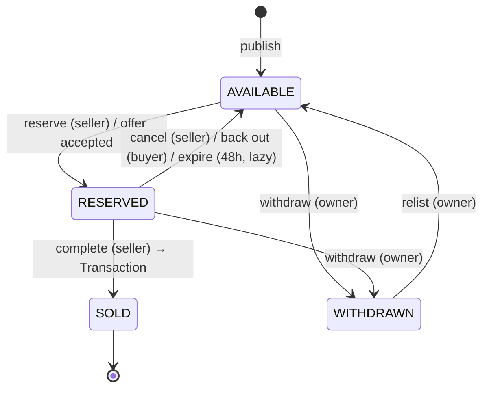

# CampusCart — Build Plan

CampusCart is a buy-and-sell marketplace limited to students of one college. Users verify with their college email, list items with photos, negotiate through threaded inquiries with offers, and reserve and complete sales through an enforced listing lifecycle.

Deadline: **27 Oct 2026, 11:59 PM IST**. Plan written at 16:49 IST, which leaves about 7 hours.

---

## 1. Decisions needing approval (blocking Phase 1)

| # | Question | Proposal |
|---|----------|----------|
| D1 | Email verification provider | **6-digit code sent by email over SMTP (nodemailer)**. The recommended SMTP account is Gmail with an App Password. It is free, can send to any address, and needs no domain. Resend is an alternative only if you own a verified domain, because without one Resend sends only to your own address. If no SMTP is configured in dev, the code is printed to the server log. |
| D2 | Allowed domains | `ALLOWED_EMAIL_DOMAINS` = your college domain(s) **plus `example.edu`**, which is the demo domain for the seeded accounts. Tell me your college's email domain. |
| D3 | Counter-offers | When the seller counters, the buyer's offer becomes `COUNTERED` and a new `PENDING` offer is created with the seller as proposer. **General rule: the recipient of a pending offer may accept, reject or counter it, and the proposer may withdraw it.** This lets the buyer accept a seller's counter. |
| D4 | Draft listings | Photo uploads need an existing listing, because the token route checks ownership. The Sell form therefore (1) saves the details as an unpublished listing (`publishedAt = null`), (2) uploads photos, and (3) publishes once at least 1 photo is attached. Unpublished listings appear only in "My listings". This adds no new `ListingStatus` value. |
| D5 | Deleting listings | The owner can hard-delete a listing, along with its blobs, only if it has no conversations and is not SOLD. Otherwise it must be withdrawn, so buyers' history is kept. |
| D6 | Manual reservation price | When the seller reserves from a conversation without an accepted offer, `reservedPrice` = the current listing price. |

## 2. Accounts and keys you need

| What | Where | Env vars produced |
|------|-------|-------------------|
| GitHub repo `parvcsinclined/campuscart` (empty, public) | github.com/new | none |
| **GitHub CLI**, which is not installed | `brew install gh`, then `gh auth login` | none |
| **Vercel CLI**, which is not installed | `npm i -g vercel`, then `vercel login` | none |
| Neon Postgres via Vercel Marketplace | Vercel project → Storage → Create Database → Neon → connect to all environments | `DATABASE_URL` (pooled), `DATABASE_URL_UNPOOLED` |
| Vercel Blob | Vercel project → Storage → Create → Blob → connect to all environments | `BLOB_READ_WRITE_TOKEN` |
| Gmail App Password (D1) | Google Account → Security → 2-Step Verification on → App passwords → create "CampusCart" | `SMTP_HOST=smtp.gmail.com`, `SMTP_PORT=465`, `SMTP_USER`, `SMTP_PASSWORD`, `EMAIL_FROM` |
| Auth secret | generated by me with `npx auth secret` | `AUTH_SECRET` |
| Allowed domains | your decision (D2) | `ALLOWED_EMAIL_DOMAINS` |

**Git identity:** `git config user.email` is currently unset. Before the first commit, set it to the email on the `parvcsinclined` GitHub account. Run `git config user.email "<that email>"` and `git config user.name "<your name>"`, or tell me the values.

## 3. Tech notes and stack versions

- **Next.js** (latest, App Router, TS, `src/` dir, Node runtime everywhere). `create-next-app` refuses a non-empty directory, so I'll scaffold in the scratchpad and move the files in. If the installed version is Next 16, route protection uses `proxy.ts` instead of `middleware.ts`.
- **Prisma** (latest) with `DATABASE_URL` at runtime and `DATABASE_URL_UNPOOLED` for migrations. Prisma 7 moves URLs into `prisma.config.ts` and requires a driver adapter (`@prisma/adapter-neon` / `adapter-pg`). I'll adapt the datasource block below to whichever major version is installed.
- **Auth.js v5** Credentials provider. Credentials only supports **JWT sessions**, which are stored in an encrypted, httpOnly, SameSite=Lax cookie. Verified status is **re-read from the DB on every guarded request** (`requireVerifiedUser`), so a stale JWT can't bypass verification.
- **Rate limiting** uses a Postgres `RateLimit` table with a fixed window and an atomic `INSERT … ON CONFLICT DO UPDATE … RETURNING`. In-memory limits don't work across Vercel serverless instances, and this avoids adding Redis.
- **Mutations are Route Handlers under `/api`** that return real HTTP status codes (400/401/403/404/409/429). Reads happen in Server Components that call the service layer directly. All business rules live in `src/lib/services` and `src/lib/domain`, never in route files.

## 4. Prisma schema

```prisma
generator client {
  provider = "prisma-client-js"
}

datasource db {
  provider  = "postgresql"
  url       = env("DATABASE_URL")          // pooled (runtime)
  directUrl = env("DATABASE_URL_UNPOOLED") // direct (migrations)
}

enum Category      { TEXTBOOKS CALCULATORS FURNITURE ELECTRONICS OTHER }
enum Condition     { NEW LIKE_NEW GOOD FAIR }
enum ListingStatus { AVAILABLE RESERVED SOLD WITHDRAWN }
enum OfferStatus   { PENDING ACCEPTED REJECTED COUNTERED WITHDRAWN EXPIRED }
enum MessageType   { TEXT OFFER SYSTEM }

model User {
  id            String    @id @default(cuid())
  name          String
  email         String    @unique              // stored lowercased
  passwordHash  String
  emailVerified DateTime?
  createdAt     DateTime  @default(now())

  listings            Listing[]           @relation("SellerListings")
  reservations        Listing[]           @relation("ReservedFor")
  verificationTokens  VerificationToken[]
  buyerConversations  Conversation[]      @relation("BuyerConversations")
  sellerConversations Conversation[]      @relation("SellerConversations")
  messages            Message[]
  offersProposed      Offer[]
  purchases           Transaction[]       @relation("Buyer")
  sales               Transaction[]       @relation("Seller")
  listingEvents       ListingEvent[]
}

model VerificationToken {
  id        String   @id @default(cuid())
  userId    String
  codeHash  String                            // sha256(code + AUTH_SECRET); never store plain code
  expiresAt DateTime                          // now + 15 min
  attempts  Int      @default(0)              // locked after 5 wrong tries
  createdAt DateTime @default(now())
  user      User     @relation(fields: [userId], references: [id], onDelete: Cascade)

  @@index([userId])
}

model Listing {
  id             String        @id @default(cuid())
  sellerId       String
  title          String        @db.VarChar(120)
  description    String        @db.VarChar(4000)
  category       Category
  condition      Condition
  priceInr       Int                          // whole rupees
  pickupLocation String        @db.VarChar(120)
  status         ListingStatus @default(AVAILABLE)
  publishedAt    DateTime?                    // null = draft (D4)
  reservedForId  String?
  reservedPrice  Int?
  reservedUntil  DateTime?                    // reservedAt + 48h; checked lazily
  createdAt      DateTime      @default(now())
  updatedAt      DateTime      @updatedAt
  // GENERATED ALWAYS AS (setweight(to_tsvector('english', title),'A') ||
  //                      setweight(to_tsvector('english', description),'B')) STORED
  // — generated expression added by hand in the migration SQL
  searchVector   Unsupported("tsvector")?

  seller        User           @relation("SellerListings", fields: [sellerId], references: [id], onDelete: Cascade)
  reservedFor   User?          @relation("ReservedFor", fields: [reservedForId], references: [id], onDelete: SetNull)
  images        ListingImage[]
  conversations Conversation[]
  offers        Offer[]
  events        ListingEvent[]
  transaction   Transaction?

  @@index([searchVector], type: Gin)
  @@index([status, publishedAt, createdAt])
  @@index([status, category])
  @@index([status, priceInr])
  @@index([sellerId, status])
  @@index([status, reservedUntil])            // lazy expiry sweep
}

model ListingImage {
  id        String   @id @default(cuid())
  listingId String
  url       String
  pathname  String                            // blob pathname, used for del()
  position  Int                               // 0..4 display order
  createdAt DateTime @default(now())
  listing   Listing  @relation(fields: [listingId], references: [id], onDelete: Cascade)

  @@index([listingId, position])
}

model Conversation {
  id             String   @id @default(cuid())
  listingId      String
  buyerId        String
  sellerId       String                       // denormalised for inbox queries
  lastMessageAt  DateTime @default(now())
  buyerLastReadAt  DateTime @default(now())
  sellerLastReadAt DateTime @default(now())
  createdAt      DateTime @default(now())

  listing  Listing   @relation(fields: [listingId], references: [id], onDelete: Cascade)
  buyer    User      @relation("BuyerConversations", fields: [buyerId], references: [id], onDelete: Cascade)
  seller   User      @relation("SellerConversations", fields: [sellerId], references: [id], onDelete: Cascade)
  messages Message[]
  offers   Offer[]

  @@unique([listingId, buyerId])              // exactly one inquiry per (listing, buyer)
  @@index([buyerId, lastMessageAt])
  @@index([sellerId, lastMessageAt])
}

model Message {
  id             String      @id @default(cuid())
  conversationId String
  senderId       String?                      // null for SYSTEM messages
  type           MessageType @default(TEXT)
  body           String      @db.VarChar(2000)
  offerId        String?                      // set for type OFFER
  createdAt      DateTime    @default(now())

  conversation Conversation @relation(fields: [conversationId], references: [id], onDelete: Cascade)
  sender       User?        @relation(fields: [senderId], references: [id], onDelete: SetNull)
  offer        Offer?       @relation(fields: [offerId], references: [id], onDelete: SetNull)

  @@index([conversationId, createdAt])
}

model Offer {
  id             String      @id @default(cuid())
  conversationId String
  listingId      String                       // denormalised: expire all pending offers on a listing
  proposerId     String
  amountInr      Int
  status         OfferStatus @default(PENDING)
  counterOfId    String?     @unique          // the offer this one counters
  respondedAt    DateTime?
  createdAt      DateTime    @default(now())

  conversation Conversation @relation(fields: [conversationId], references: [id], onDelete: Cascade)
  listing      Listing      @relation(fields: [listingId], references: [id], onDelete: Cascade)
  proposer     User         @relation(fields: [proposerId], references: [id], onDelete: Cascade)
  counterOf    Offer?       @relation("CounterChain", fields: [counterOfId], references: [id])
  counteredBy  Offer?       @relation("CounterChain")
  messages     Message[]
  transaction  Transaction?

  @@index([listingId, status])
  @@index([conversationId, createdAt])
  // + raw SQL partial unique index (migration):
  //   CREATE UNIQUE INDEX "Offer_one_pending_per_conversation"
  //     ON "Offer"("conversationId") WHERE status = 'PENDING';
}

model Transaction {
  id          String   @id @default(cuid())
  listingId   String   @unique                // a listing can be sold once
  buyerId     String
  sellerId    String
  offerId     String?  @unique
  finalPrice  Int
  completedAt DateTime @default(now())

  listing Listing @relation(fields: [listingId], references: [id], onDelete: Cascade)
  buyer   User    @relation("Buyer", fields: [buyerId], references: [id])
  seller  User    @relation("Seller", fields: [sellerId], references: [id])
  offer   Offer?  @relation(fields: [offerId], references: [id])

  @@index([buyerId, completedAt])
  @@index([sellerId, completedAt])
}

model ListingEvent {
  id         String         @id @default(cuid())
  listingId  String
  actorId    String?                          // null = system (e.g. lazy expiry)
  fromStatus ListingStatus?                   // null for creation/publish
  toStatus   ListingStatus
  reason     String?                          // "offer_accepted", "reservation_expired", "buyer_backed_out", …
  createdAt  DateTime       @default(now())

  listing Listing @relation(fields: [listingId], references: [id], onDelete: Cascade)
  actor   User?   @relation(fields: [actorId], references: [id], onDelete: SetNull)

  @@index([listingId, createdAt])
}

model RateLimit {
  key     String   @id                        // e.g. "login:ip:1.2.3.4", "offer:user:abc"
  count   Int
  resetAt DateTime
}
```

Two parts can't be expressed in the Prisma schema, so they are hand-written in the migration SQL: the **partial unique index** (one PENDING offer per conversation) and the **generated tsvector column**. Phase 3 verifies that `prisma migrate dev` reports no drift on the generated column. If it does, the fallback is a trigger-maintained column.

## 5. State machines (`src/lib/domain/`)

### Listing (`listing-state.ts`)



- The module is a pure table of `action → { from: ListingStatus[], to, allowedActor: 'seller' | 'reservedBuyer' | 'system' }` plus `canTransition(listing, action, actor)` and `canEdit(listing)`, which is false only when the listing is SOLD.
- Execution goes through `transitionListing()` in `services/listings.ts` inside `prisma.$transaction`, as follows:
  1. `updateMany({ where: { id, status: expectedFrom, …(reservedForId for back-out) }, data })`. If the count is 0, re-read the listing: if it is missing, return **404**; otherwise return **409** with the current status.
  2. Insert a `ListingEvent`.
  3. Side effects. Moving to RESERVED or SOLD sets every PENDING offer on the listing to `EXPIRED` (except an offer being accepted) and posts a SYSTEM message in each affected conversation. Moving to WITHDRAWN does the same. Moving out of RESERVED clears the `reserved*` fields and posts a SYSTEM message to the reserved buyer. Moving to SOLD creates the `Transaction`.
- **Lazy expiry.** `expireStaleReservations(listingIds?)` runs a single `UPDATE … WHERE status='RESERVED' AND "reservedUntil" < now() RETURNING id`. For each returned row it writes a `ListingEvent` (actor null, reason `reservation_expired`) and a SYSTEM message. It runs before listing detail and search reads and before every transition and offer action.

### Offer (`offer-rules.ts`)

```
PENDING ──accept (recipient)──▶ ACCEPTED   (atomically reserves listing at amount)
PENDING ──reject (recipient)──▶ REJECTED
PENDING ──counter (recipient)─▶ COUNTERED  (+ new PENDING offer by recipient)
PENDING ──withdraw (proposer)─▶ WITHDRAWN
PENDING ──(listing leaves AVAILABLE)──▶ EXPIRED   (system)
```

- **Create:** the actor must be a participant, the listing must be `AVAILABLE`, and the first offer in a conversation must come from the buyer. The amount is an integer from 1 to 10,000,000. No other PENDING offer may exist in the conversation; this is checked in code and backed by the partial unique index, and either failure returns **409**. Each offer also creates an `OFFER` message so it appears in the thread.
- **Accept** runs in one `$transaction`. It updates the offer `where status=PENDING` to ACCEPTED, then reserves the listing atomically (`where status=AVAILABLE`) for the conversation's buyer with `reservedPrice = amount` and `reservedUntil = now + 48h`. If either step finds nothing to update, the transaction rolls back and returns **409**.
- Pure functions that can be unit-tested: `canCreateOffer`, `canRespond(offer, actorId, action)`, `nextStatus`.

## 6. Pages

| Route | Access | Purpose |
|-------|--------|---------|
| `/` | public | Landing page. Redirects verified users to `/browse` |
| `/signup`, `/login` | public | Auth forms with field errors |
| `/verify` | logged in | Enter the 6-digit code, with a resend button that has a cooldown |
| `/browse` | verified | Search, filters, sort and pagination, all state kept in URL `searchParams` |
| `/listings/[id]` | verified | Gallery, details, status badge, "Message seller"/"Make offer"; for the owner: actions and event timeline |
| `/sell` | verified | Create: details → photos → publish |
| `/listings/[id]/edit` | owner, not SOLD | Edit details and add, remove or reorder photos |
| `/my/listings` | verified | Grouped: Drafts, Available, Reserved, Sold, Withdrawn |
| `/my/purchases`, `/my/sales` | verified | Completed transactions |
| `/inbox` | verified | Conversations with unread counts, newest first |
| `/inbox/[id]` | participant | Thread with messages, offer cards and system messages; polls every 4s; reserve/complete actions |
| `/profile` | logged in | Name, email, verification status, sign out |
| `not-found.tsx`, `error.tsx`, `loading.tsx` | — | Global and per-segment states |

## 7. API routes (all mutations; Node runtime)

| Method & path | Rules |
|---------------|-------|
| `GET/POST /api/auth/[...nextauth]` | Auth.js. The login rate limit is applied in `authorize()` |
| `POST /api/auth/signup` | Zod validation, domain allowlist, bcrypt (cost 10), rate limit, sends code |
| `POST /api/auth/verify` | Rate limit, attempts counter, expiry check |
| `POST /api/auth/verify/resend` | 60s cooldown |
| `POST /api/listings` | Creates a draft (verified users) |
| `PATCH /api/listings/[id]` | Owner only, `canEdit` |
| `DELETE /api/listings/[id]` | Owner only, D5 rules, deletes blobs |
| `POST /api/listings/[id]/publish` | Owner only, requires ≥1 image |
| `POST /api/listings/[id]/transition` | `{ action: reserve\|cancel\|backout\|complete\|withdraw\|relist, conversationId? }` → state machine; returns 409 on conflict |
| `POST /api/blob/upload` | `handleUpload` from `@vercel/blob/client`; `onBeforeGenerateToken` checks session, verified status, listing ownership via `clientPayload`, fewer than 5 images, and returns `allowedContentTypes` [jpeg, png, webp] and `maximumSizeInBytes` 5 MB |
| `POST /api/listings/[id]/images` | Attaches an uploaded blob. Checks ownership, that the URL host belongs to our Blob store, and the count. Called by the client after upload, because `onUploadCompleted` webhooks don't reach localhost |
| `PATCH /api/listings/[id]/images` | Reorder |
| `DELETE /api/listings/[id]/images/[imageId]` | Owner only; `del()` the blob; must leave ≥1 image if published |
| `POST /api/listings/[id]/conversations` | Opens an inquiry. Returns 201 when new and 200 when it already exists (upsert on the unique key); 403 for the owner |
| `GET /api/conversations/[id]/messages?after=<iso>` | Participant only; polling endpoint; also returns current offer and listing state |
| `POST /api/conversations/[id]/messages` | Participant only, rate limit, Zod |
| `POST /api/conversations/[id]/read` | Sets the caller's `lastReadAt` |
| `POST /api/conversations/[id]/offers` | Creates an offer (rate limited) |
| `POST /api/offers/[id]` | `{ action: accept\|reject\|counter\|withdraw, amountInr? }` |
| `GET /api/inbox/unread` | Total unread count for the nav badge (polled) |

Every handler is wrapped in `withErrorHandling()`. It maps `AppError(status, code, message, fieldErrors?)` to JSON, maps Zod errors to 400 with `fieldErrors`, and maps Prisma `P2002` to 409 and `P2025` to 404. Unknown errors are logged with a request id and returned as a generic 500.

## 8. Folder structure

```
prisma/
  schema.prisma  migrations/  seed.ts  seed-images/
src/
  app/
    page.tsx                         landing
    (auth)/login  signup  verify
    (app)/layout.tsx                 nav + requireVerifiedUser
    (app)/browse  sell  listings/[id]  listings/[id]/edit
    (app)/my/listings  my/purchases  my/sales
    (app)/inbox  inbox/[id]  profile
    api/…                            (see §7)
    not-found.tsx  error.tsx  global-error.tsx
  components/                        ui primitives, ListingCard, StatusBadge, PhotoUploader,
                                     FilterBar, Pagination, MessageThread, OfferCard, Timeline, Toaster
  lib/
    db.ts            Prisma singleton
    env.ts           Zod-validated process.env
    auth.ts          Auth.js config
    authz.ts         requireUser / requireVerifiedUser / assertListingOwner / assertParticipant
    errors.ts        AppError + http helpers + withErrorHandling
    rate-limit.ts    Postgres fixed-window limiter
    email.ts         nodemailer or console fallback
    api-client.ts    fetch wrapper → typed result, friendly errors
    image.ts         browser resize/compress (canvas → WebP/JPEG, max 1600px)
    validation/      zod schemas shared by client + server
    domain/          listing-state.ts, offer-rules.ts (+ *.test.ts)
    services/        listings.ts, search.ts, images.ts, conversations.ts, offers.ts,
                     transactions.ts, users.ts
  proxy.ts / middleware.ts           redirect unauthenticated users from app routes
```

## 9. Build order and checklist

Times are estimates, starting at about 17:00 IST. Total ≈ 6½ h, leaving roughly 30 min of buffer.

### Phase 1 — Setup, auth, campus restriction, first deploy (~75 min)
- [x] Install `gh` and `vercel` CLIs, set git identity, confirm the GitHub repo exists
- [x] Scaffold Next.js + Tailwind + ESLint + Vitest; Prisma init; `.env.example`
- [x] Vercel project link; add Neon from the Storage tab; `vercel env pull`
- [x] Blob store connected (OIDC: `BLOB_STORE_ID` + `VERCEL_OIDC_TOKEN`, no read-write token)
- [x] Full schema + first migration (including the partial index and tsvector)
- [x] `env.ts`, `errors.ts`, `rate-limit.ts`, `authz.ts`, `email.ts`
- [x] Sign up with domain allowlist, bcrypt, Auth.js credentials login, verify code, logout
- [x] Landing page, app layout with nav, route protection
- [x] Seed two demo users (`seller@example.edu`, `buyer@example.edu`)
- [x] Unit tests for authz helpers
- [x] lint + typecheck + test → Chrome test → commit and push → **deploy, run migrations on prod, seed demo users, smoke test**
- Notes: Next 16.4 with Cache Components off; Prisma 7.10.1 + `@prisma/adapter-pg`; dev and prod share one Neon DB; live at https://campuscart-mu-navy.vercel.app

### Phase 2 — Listings and photos (~75 min)
- [x] Listing Zod schemas, create draft, edit, publish, delete, with field errors
- [x] Blob presigned-upload route (OIDC), attach/delete image routes (reorder cut: first photo = cover)
- [x] PhotoUploader: client resize, per-photo progress, error and retry
- [x] Listing detail page with gallery and status badge (+ My listings grouped by status, pulled forward from Phase 3)
- [x] Check → commit → push → deploy → smoke test (prod upload to be confirmed by user login)

### Phase 3 — Search and filters (~35 min)
- [x] `services/search.ts`: FTS (`websearch_to_tsquery`) + filters + sort + pagination via `Prisma.sql`
- [x] Browse page with URL-synced FilterBar, empty state, pagination
- [x] My listings grouped by status
- [x] Check → commit → push → deploy → smoke test

### Phase 4 — Inquiries, messaging, offers (~75 min)
- [ ] Open or reuse a conversation; owner blocked
- [ ] Thread page, send message, 4s polling (paused while the tab is hidden), read markers
- [ ] Inbox with unread counts and nav badge
- [ ] Offer create/accept/reject/counter/withdraw (accept → reserve wired in Phase 5) and offer cards in the thread
- [ ] Unit tests for offer rules
- [ ] Check → commit → push → deploy → smoke test

### Phase 5 — Reservations, completion, lifecycle (~75 min)
- [ ] `listing-state.ts` + unit tests
- [ ] `transitionListing` with atomic updates, events, offer expiry and system messages
- [ ] Accept offer → reserve; seller reserve, cancel, complete; buyer back out; withdraw and relist
- [ ] Lazy 48h expiry
- [ ] Seller timeline; My purchases and My sales
- [ ] Concurrency check (two simultaneous reserve requests → one 200, one 409)
- [ ] Check → commit → push → deploy → smoke test

### Phase 6 — Polish, tests, seed, README, final deploy (~60 min)
- [ ] Loading, empty and error states on every page; toasts; mobile pass
- [ ] Seed 12 realistic listings with photos (uploaded to Blob by the seed script)
- [ ] README with all GUIDELINES sections, Mermaid architecture and lifecycle diagrams, engineering decisions, limitations, demo credentials
- [ ] Final deploy, prod seed, full Chrome smoke test as both users, links checked in an incognito window

**If time runs short, cut in this order:** photo reordering, counter-offers (keep accept/reject/withdraw), the nav unread badge (keep inbox counts), and the seller timeline UI (events are still recorded).

**Extras (only after production is green):** seller ratings, saved listings, report listing.

## 10. Reference notes (quality bar only)

Notes from the public pages of a friend's project, CodeMentor (`/`, `/problems`, and an unknown URL to see the 404). I didn't sign up, log in or submit forms. **Nothing is copied:** CampusCart gets its own name, palette, copy, logo and features.

**What makes it feel finished**
- **Consistent shell.** The same sticky top nav (logo, 2 links, theme toggle, Log in, primary CTA) and the same slim footer appear on every page, including the 404.
- **Typography and spacing.** One large, confident heading per page, a small uppercase "eyebrow" label above it, a muted one-line subtitle, generous whitespace, and content in rounded cards with soft borders. There is clear visual hierarchy without clutter.
- **Landing page.** A hero with one primary CTA plus a secondary text link and a visual of the product in use, then three short feature cards and a closing CTA band. It explains the product in about 5 seconds.
- **List page.** A search box and filter dropdowns sit in one toolbar card above a table. There is a count badge, a footer row inside the card, and a tip card below.
- **Custom 404.** It is on-brand, has a friendly headline, and offers one button back to the main list page.
- **Dark-mode toggle** in the nav.
- **Load speed.** Pages rendered almost instantly with no console errors.

**Weaknesses to avoid**
- `/problems` stayed on "Loading problems…" with a "0 problems" counter after more than 5 s, with no error, empty or "log in to see problems" state. *CampusCart: every fetch has a timeout and resolves to content, an empty state or an error state with a Retry button. A loading state is never the final state.*
- The 404 page kept the generic site `<title>`. *CampusCart: set a per-page `metadata.title` (e.g. "Calculus textbook · CampusCart", "Not found · CampusCart").*
- Mobile is unverified because the browser window couldn't be resized. I'll check CampusCart at 390 px myself in Chrome DevTools.

**Ideas applied to CampusCart, with its own identity**
- A shared app shell: top nav on desktop, **bottom tab bar on mobile** (Browse, Sell, Inbox with badge, My listings, Profile), since buyers mostly use phones.
- A page-header pattern (eyebrow, title, subtitle, primary action) used on every page.
- A browse toolbar card with search and filters synced to the URL, and a result count.
- A custom 404 and error page in CampusCart's own voice, with a "Back to Browse" action.
- A landing page that explains the product quickly: hero, then "How it works" in 3 steps (Verify → List/Browse → Meet on campus), then a CTA.
- Skeleton loaders instead of "Loading…" text; designed empty states with a next action ("No listings match — clear filters").
- CampusCart's own palette (for example a warm green/teal "campus" accent with an amber "Reserved" badge), a different font pairing and a simple tag/cart mark. No purple gradients, code-editor visuals or similar wording.
